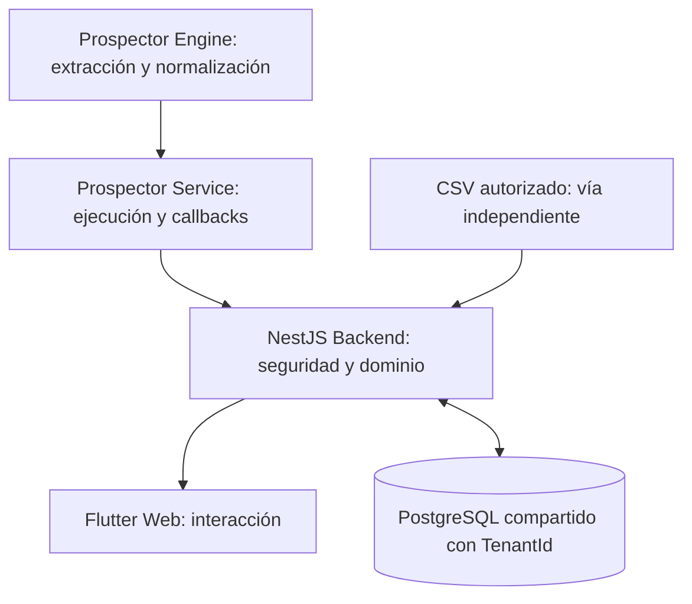
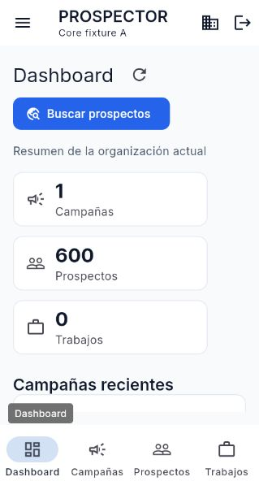
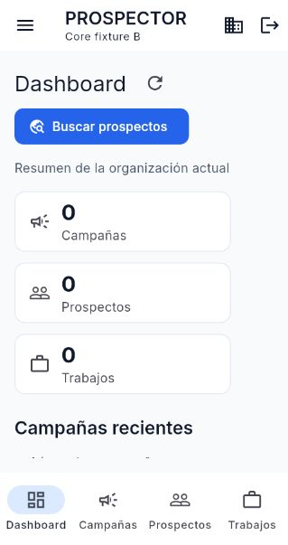
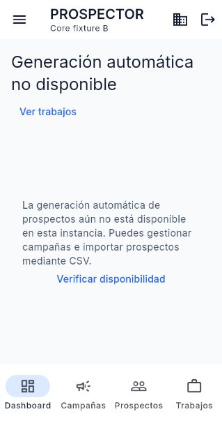

# Segundo avance — PROSPECTOR SaaS

**Presentación:** martes 27 de octubre de 2026, aproximadamente 19:00 America/Tijuana. **Corte técnico:** jornada del 27 de octubre, antes de la presentación; hora exacta/checks en [evidencia](Evidencia_Cierre_MVP_2026-10-27.json). Actualizar el estado servido justo antes de exponer. No se ejecutaron merges a dev/main ni despliegues manuales durante este cierre.

## 1. Descripción del proyecto

PROSPECTOR es una plataforma SaaS para gestionar organizaciones, equipos, campañas de marketing y prospectos comerciales. Busca reducir el trabajo manual de organizar prospectos, conservar relaciones con campañas y preparar progresivamente la generación automática de búsquedas. El MVP ya permite trabajo útil mediante altas manuales e importación CSV aunque el servicio de extracción no esté disponible.

## 2. Arquitectura global



Flutter consume exclusivamente el contrato público del Backend. El Backend autoriza, valida y persiste. Service no decide permisos del dominio; Engine no administra campañas ni usuarios. En el release inicial propuesto, generación deshabilitada: Flutter→NestJS→PostgreSQL sigue operando sin Service.

## 3. Modelo SaaS multi-tenant

Tenant representa una organización. Usuario es una identidad global con membresías y roles por organización. OWNER/MEMBER expresan permisos locales; ADMIN es autoridad de plataforma. Campaña agrupa objetivos y relaciones con prospectos; Prospecto es el registro comercial del tenant; Job conserva una intención y su ejecución de prospección.

Se utiliza Shared Database + Shared Schema: tablas compartidas y TenantId. El tenant se toma del contexto autenticado, no de un body manipulable. Consultas, escrituras, conteos y relaciones comprueban pertenencia. Un ID ajeno responde de forma segura sin revelar el recurso.

La auditoría encontró y corrigió tres riesgos: autoridad revocada que seguía viva en JWT, modificación de identidades globales por OWNER y diálogos con información anterior después del cambio de sesión. Ahora la autorización se verifica contra PG en cada petición y Flutter descarta estado/respuestas/diálogos del contexto anterior. Esto está respaldado por pruebas negativas A/B; no se presenta sólo como una decisión de diseño.

## 4. Funcionalidades implementadas y estado efectivo

| Módulo | Implementado y validado en entorno controlado | Estado productivo comprobado |
|---|---|---|
| Auth y tenants | Login, sesión, selección/cambio, roles, logout/expiración | Smoke autenticado de la revisión nueva pendiente |
| Users | Listado/detalle/crear/editar; desactivar conforme a ADMIN | Pendiente |
| Campaigns | Crear/consultar/editar/archivar y eliminación permanente contractual | Pendiente |
| Prospects | Crear manual, listar/detalle/editar y relaciones | Pendiente |
| CSV | Preview firmado, decisiones, confirm transaccional, resultados/replay | Pendiente; **main Backend ya tenía CSV V1** |
| Dashboard | Totales reales de campañas/prospectos/Jobs del tenant | Pendiente |
| Jobs | Historial y detalle; creación sólo con capacidad Backend | Lectura por validar; generación inicial deshabilitada |
| Integración externa | HTTP real con FastAPI, EnginePort controlado y callbacks | Sin despliegue/ejecución pública certificados |

Render respondió health200 y PostgreSQL up. Eso no acredita qué SHA sirve ni que esta revisión esté desplegada. Los dominios de frontend declarados devolvieron 404; la URL inmutable marcada Production redirige al login de Vercel y corresponde a una revisión anterior. No se afirma operación productiva del código corregido.

## 5. Evidencias para la exposición

Repositorios: [Engine](https://github.com/CarlosAM03/prospector-engine), [Service](https://github.com/CarlosAM03/prospector-service), [Backend](https://github.com/CarlosAM03/saas-platform-backend), [Flutter](https://github.com/CarlosAM03/saas-platform-client).

PR de auditoría: [Backend #6](https://github.com/CarlosAM03/saas-platform-backend/pull/6), [Foundation #7](https://github.com/CarlosAM03/saas-platform-client/pull/7), [paridad #8](https://github.com/CarlosAM03/saas-platform-client/pull/8), todos Draft. Foundation precede a paridad. Ninguno se aprueba/fusiona por esta ejecución.

Código Backend auditado: `42b96fefd73cc11b42ecde4df6d5f42393328bfc`; Foundation: `095e899ace31acf17d97bbe945c118c1a5d88682`; paridad y herramientas finales: ver JSON de evidencia y HEAD de #8. Contrato público 1.1.0. [CI Backend aprobado](https://github.com/CarlosAM03/saas-platform-backend/actions/runs/40481064364) y [Foundation aprobado](https://github.com/CarlosAM03/saas-platform-client/actions/runs/40480231249). Checks exactos de paridad, commits de documentación y hora de corte se concentran en la evidencia para evitar atribuir checks viejos a un HEAD nuevo.

Resultados: Backend 68 unitarios, 77 HTTP y 46 PG; Flutter Foundation255 y paridad267, más dos integraciones explícitas aprobadas por separado. Lint/typecheck/build, analyze/build_runner/Web release aprobados. CI valida imágenes y smoke frontend. No se ejecutó Docker local; arranque de contenedor Backend productivo pendiente. Engine247 y Service94/ruff son evidencia previa del mismo código, no reruns de esta jornada.

Capturas de la **Web release real local**, conectada al entrypoint compilado de NestJS y PG aislado sin Service:







## 6. Demostración CSV

La prueba usa [prospects-demo-600.csv](../examples/prospects-demo-600.csv): 600 negocios inventados, direcciones de demostración, correos example.com y valores de texto con acentos/ceros iniciales. Ningún contacto DATRA se incluye en este material.

Flujo real Web observado: login de cuenta efímera local→selección de tenant A→Prospectos→Importar CSV→campaña Core CSV600→archivo sintético→preview **600 nuevas, 0 coincidencias/invalidas/conflictos**→confirmación de decisiones→**600 creados, 0 vinculados/actualizados/omitidos/rechazados**→dashboard **600**→cambio a B→dashboard **0**. Generación aparece explícitamente indisponible y Jobs permanece legible con cero registros.

La integración automatizada independiente incluye además un prospecto manual: por eso su dashboard esperado es **601**, no 600. Allí también se probó replay409, campaña de A inaccesible desde B, rechazo503 de crear Job y cero llamadas fetch del Backend hacia Service. Los dos conteos pertenecen a fixtures separados y no se suman.

Los seis XLSX autorizados del CLI reúnen **486 filas**, no un archivo único de 600. La inspección privada y el parser real clasificaron 422 compatibles y 64 filas con nombres normalizados repetidos que requieren revisión al combinar consultas. No se deduplicaron ni importaron contactos reales. La conversión reproducible sólo cambia los encabezados al contrato y deja candidatos/manifiesto/ledger privados; detalles en preauditoría. Este material histórico muestra formato y volumen, no extracción nueva del Engine SaaS.

## 7. Prospector Engine

El Engine concentra Google Maps, extracción, normalización e identidad verificada, con incidencias y resultados parciales observables. Límite actual 1–100 por búsqueda. Requiere navegador/entorno compatible. El CLI portátil es antecedente funcional; no es idéntico al Engine integrado. Esta demostración CSV no ejecuta Google Maps ni valida una extracción pública actual. No se amplió su contrato ni se modificó su código.

## 8. Service externo

FastAPI expone admisión autenticada de Jobs, cola/worker y ejecución del Engine fuera del event loop; comunica estados/resultados/errores mediante callbacks al Backend. La integración HTTP se probó con el Service real y un EnginePort controlado para resultados deterministas, errores y callbacks.

Su registro es en memoria y la capacidad es acotada. No hay persistencia durable del registro, outbox, reanudación automática, GET público de resultados, cancelación HTTP ni exportación HTTP. Backend ofrece snapshots temporales de una hora; no guarda scraping en campañas. La activación requiere infraestructura, credenciales internas, HTTPS/callback, capacidad/cuotas y extracción E2E real aprobadas. Hasta entonces, Service no es dependencia del núcleo y PROSPECTOR_ENABLED=false.

## 9. Resultados y límites honestos

- Núcleo validado sin Service, tanto por APIs reales como por la Web local.
- P0 reproducidos y corregidos; pruebas A/B, roles, JWT anterior, callbacks tardíos y limpieza de sesión aprobadas.
- CSV600 confirmado en PostgreSQL con aislamiento y manejo de replay; datos reales mantenidos privados.
- Ramas publicadas, Draft PR y CI revisables; se conservan fallos iniciales y su corrección en el historial.
- Producción pendiente de dominio efectivo/CORS, SHA servido, cuentas/secretos, migraciones, backup/restore, límites/costos y smoke autenticado.
- La extracción externa y su recuperación durable no se anuncian como productivas. Cancel/export/persist HTTP y nuevas fuentes quedan fuera de este MVP.

## 10. Siguiente etapa

Auditoría humana final→Backend a dev→Foundation a dev→retarget y revisión de paridad a dev→CI/smoke→revisión dev→main→backup/migración/despliegue con autorización posterior→smoke de la revisión servida. Activar Service es una etapa posterior con gate P3 independiente. El orden y rollback se detallan en readiness.

## Guion de demostración (8–10 minutos)

| Tiempo | Acción | Frase verificable |
|---|---|---|
| 0:00–1:00 | Problema y arquitectura | “El núcleo trabaja aunque no despleguemos la generación externa” |
| 1:00–2:00 | Login y tenant A | “Una identidad tiene membresías y permisos por organización” |
| 2:00–3:00 | Campañas/prospecto manual | “Los datos pertenecen al tenant activo; no elegimos tenantId en el formulario” |
| 3:00–5:00 | Importar CSV sintético y revisar preview/decisiones | “Son 600 filas inventadas; cada confirmación se valida y se aplica transaccionalmente” |
| 5:00–6:00 | Resultado y dashboard | “El total viene de PostgreSQL, no de contar los elementos visibles” |
| 6:00–7:00 | Cambiar a B | “B no ve los prospectos de A; los IDs ajenos también se rechazan por Backend” |
| 7:00–8:00 | Generación indisponible e historial | “Sólo esta capacidad está apagada; campañas y CSV continúan funcionando” |
| 8:00–9:00 | PR/CI y evidencia HTTP separada | “FastAPI y callbacks se validaron con EnginePort controlado; no afirmamos extracción pública” |
| 9:00–10:00 | Pendientes de producción | “La promoción requiere revisión, backup, dominio/CORS y autorización; no se hizo un despliegue inseguro por horario” |

Si se añade el prospecto manual antes del CSV, el total esperado es601; si se reproduce el ensayo Web capturado sin el manual, es600. Usar un tenant desechable nuevo para repetir la importación completa. No repetir confirm ante respuesta incierta: consultar resultado/conteos y regenerar preview; no aplicar UPDATE_EXISTING a datos reales compartidos sin autorización.

## Reproducir el entorno controlado

Usar Node20 y Flutter3.47.5, PostgreSQL **local desechable**, base cuyo nombre termine en `_test`. No utilizar DATABASE_URL productivo. El harness crea tenants/cuenta efímeros y prepara `.tmp/core-stack.json` privado; no imprimirlo ni subirlo como evidencia. El backend arranca el entrypoint real con NODE_ENV=production, JWT aleatorio, cwd sin .env y sin Service.

En el checkout Backend, en una terminal dedicada:

```powershell
$env:INTEGRATION_TEST_DATABASE_URL = 'postgresql://<usuario>:<secreto>@127.0.0.1:<puerto>/<base>_test'
$env:DATABASE_URL = $env:INTEGRATION_TEST_DATABASE_URL
npm ci
npm run prisma:generate
npm run prisma:migrate:deploy
npm run build
node test/scripts/core-stack.cjs
```

En Flutter, para prueba automatizada contra ese proceso:

```powershell
flutter pub get
dart run build_runner build
flutter test test/integration/core_stack_test.dart --dart-define=CORE_MANIFEST=<ruta-absoluta-Backend>/.tmp/core-stack.json
```

Para ensayo visual, usar **otro harness nuevo o tenant limpio** tras cerrar el anterior. El test automatizado ya importó600 y no debe usarse como base para otra importación completa de la misma muestra. Compilar y servir en loopback:

```powershell
flutter build web --release --no-wasm-dry-run --dart-define=API_BASE_URL=http://127.0.0.1:18420
node tool/core-demo-server.cjs <ruta-absoluta-Backend>/.tmp/core-stack.json
```

Abrir `http://127.0.0.1:18420`, usar en privado la cuenta efímera del manifest y seleccionar A. El servidor de ensayo sólo escucha127.0.0.1, sirve la Web y reenvía `/api` al Backend local validado por el manifest. No es infraestructura productiva ni modifica CORS de producción. No reutilizar este build con API loopback para desplegar; generar otro con API_BASE_URL HTTPS autorizado.

Para cerrar: Ctrl+C del servidor Web y escribir el stopFile del manifest en Backend:

```powershell
node -e "const f=require('./.tmp/core-stack.json');require('node:fs').writeFileSync(f.stopFile,'stop')"
```

El harness retira exclusivamente sus fixtures y su proceso; conservar la base/cluster propio o detenerlo con la herramienta PG correspondiente, sin tocar el PostgreSQL habitual de5432. No borrar árboles de temporales con rutas calculadas. El ensayo capturado utiliza el cluster aislado de esta jornada, no datos del dominio productivo.

## Evidencia de la jornada

Al inicio estaban publicados main/dev Backend con CSV V1, Foundation y ramas locales de integración sin un cierre productivo certificado. Primero se publicaron las ramas y abrieron Draft PR. Después se reprodujeron los P0, se corrigieron y se validó núcleo sin Service/CSV600; se corrigieron dependencias y pipelines limpios. La revisión efectivamente desplegada **no cambió por una promoción autorizada durante esta ejecución**. GitHub informa previews automáticos y un Production anterior protegido; los health públicos sólo prueban disponibilidad parcial. Para las19:00 se debe registrar el estado real de ese momento, conservando esta demostración si los gates siguen pendientes.
